*ENSIASD Taroudant · OdemLab platform (team of 4)*

*Final-year engineering student · open to an end-of-studies internship (PFE, Feb – Jun 2027)*

---

### About me

I build full-stack apps with executable guarantees — typed contracts, tests that fail the build, pipelines that run the suite.

- 🔭 Currently shipping **[ProcureFlow](https://github.com/AhmedOL0/ProcureFlow)** — multi-tenant procurement SaaS (Spring Boot · Angular)
- 🎓 Final year @ ENSIASD — open to a PFE internship, Feb–Jun 2027

---

## Technical Stack

### Programming Languages

### Frontend & Mobile Development

### Backend & Databases

### DevOps & Cloud

### Testing & Quality

Mockito · Testcontainers · Playwright · JaCoCo · ArchUnit · SpotBugs · axe-core

### Embedded & IoT

---

## Featured

<table>
<tr>
<td width="50%" valign="top">

**[ProcureFlow](https://github.com/AhmedOL0/ProcureFlow)** 
Multi-tenant B2B procurement SaaS: JWT rotation, server-side totals, FR/EN interface, AI copilot. 
<code>Spring Boot</code> <code>Angular</code> <code>PostgreSQL</code> <code>MongoDB</code>

</td>
<td width="50%" valign="top">

**OdemLab** 
AI-augmented skincare e-commerce: order pipeline, payments, mobile app. Team of four. Private repo, demo on request. 
<code>Spring Boot</code> <code>Next.js</code> <code>React Native</code>

</td>
</tr>
</table>

---

## GitHub Analytics

---

*Backend-leaning, product-minded — executable guarantees over conventions.*

