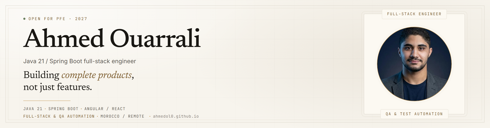

  

  <a href="https://ahmedol0.github.io"><strong>Portfolio</strong></a> ·
  <a href="https://github.com/AhmedOL0/ProcureFlow">ProcureFlow</a> ·
  <a href="https://www.linkedin.com/in/ahmed-ouarrali">LinkedIn</a> ·
  <a href="mailto:ahmedouarrali12@gmail.com">Email</a>

---

I build full-stack products with executable guarantees: typed contracts, tests that fail the build, and pipelines that run the suite.

I'm in my final year at ENSIASD and looking for a **PFE internship (February-June 2027)** in backend, full-stack or QA automation, in Morocco or Europe, on-site or remote.

| Dossier | |
| :--- | :--- |
| **Role** | PFE candidate · full-stack engineer |
| **Focus** | Java 21 / Spring Boot · Angular / React · QA automation |
| **Location** | Morocco · UTC+1 · remote-friendly |
| **Status** | Open for PFE · February-June 2027 |

## Currently building

**[ProcureFlow](https://github.com/AhmedOL0/ProcureFlow)** · multi-tenant B2B procurement platform. Requests, approvals, budgets, invoices, tenant isolation and an AI copilot.

`Spring Boot` `Angular` `PostgreSQL` `MongoDB` `JWT rotation` `Docker`

## Selected work

| Project | My contribution | Stack | Dossier |
| :--- | :--- | :--- | :--- |
| **OdemLab** | Backend business modules and order flow; web storefront and back-office. Mobile app and AI diagnosis by teammates. | Spring Boot · Next.js/React · PostgreSQL/Redis · GCP | [Case study](https://ahmedol0.github.io/#case-odemlab) |
| **ProcureFlow** | Full-stack: multi-tenant requests, approvals, budgets, tenant isolation and the AI copilot. | Spring Boot · Angular · PostgreSQL/MongoDB · JWT | [Case study](https://ahmedol0.github.io/#case-procureflow) · [Repo](https://github.com/AhmedOL0/ProcureFlow) |
| **Smart Campus** | Flutter mobile: QR room sheets, AR view, timetable, bookings, announcements and incidents across three roles. Team of four. | Flutter · Firebase/Firestore · ARCore/ARKit | [Case study](https://ahmedol0.github.io/#case-smart-campus) |

The full set of seven project dossiers is on the [portfolio](https://ahmedol0.github.io/#work).

## How I build

- **Contracts first**: OpenAPI-generated frontend types, server-side pricing and totals, explicit error states.
- **Tests gate the build**: JUnit 5, Testcontainers, ArchUnit and Playwright in CI. No "works on my machine".
- **Accessible by default**: semantic HTML, visible focus, reduced motion, 44px targets and layouts from 320px to desktop.
- **Evidence over claims**: the portfolio labels my contribution versus teammates' work; no invented metrics, demos or screenshots.

## Toolbox

| Backend | Frontend and mobile | Delivery and quality |
| :--- | :--- | :--- |
| Java 21 · Spring Boot · Spring Security · PostgreSQL · MongoDB · Redis · Flyway · OpenAPI | Angular · React · Next.js · TypeScript · Flutter · Firebase | Docker · Google Cloud Run · GitHub Actions · Playwright · JUnit 5 · Testcontainers · ArchUnit |

## Evidence

The portfolio ships **7 project dossiers**, **596 Playwright checks** across Chromium, Firefox, WebKit and mobile Chrome, a crawlable no-JS fallback, and a clean Lighthouse baseline. [Open it](https://ahmedol0.github.io).

**CVs:** Full-Stack [EN](https://ahmedol0.github.io/assets/CV_Ahmed_Ouarrali_EN.pdf) / [FR](https://ahmedol0.github.io/assets/CV_Ahmed_Ouarrali_FR.pdf) · QA [EN](https://ahmedol0.github.io/assets/CV_Ahmed_Ouarrali_QA_EN.pdf) / [FR](https://ahmedol0.github.io/assets/CV_Ahmed_Ouarrali_QA_FR.pdf)

## Contact

- **Portfolio**: [ahmedol0.github.io](https://ahmedol0.github.io)
- **Email**: [ahmedouarrali12@gmail.com](mailto:ahmedouarrali12@gmail.com)
- **LinkedIn**: [ahmed-ouarrali](https://www.linkedin.com/in/ahmed-ouarrali)
- **GitHub**: [AhmedOL0](https://github.com/AhmedOL0)

---

Backend-leaning, product-minded. Evidence over claims.

